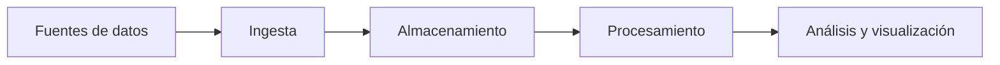
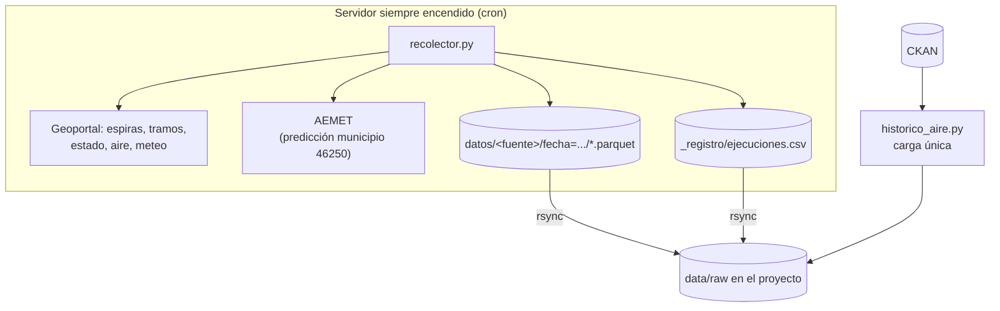

# Proyecto 4: BIGDATA

## Descripción y objetivo

Este proyecto tiene como objetivo preparar una estructura de trabajo para organizar la ingesta, el almacenamiento y el procesamiento de datos dentro del módulo de Big Data. El resultado será un flujo de trabajo documentado que permita preparar los datos para su análisis y visualización.

Caso de uso: Big Data urbano de Valencia (tráfico, calidad del aire y meteorología) con datos abiertos.

## Arquitectura



## Estructura del repositorio

```text
P4BIGDATA/
├── .gitignore
├── README.md
├── requirements.txt
├── docker-compose.yml        # NiFi (ampliación)
├── recolector/               # independiente: se copia tal cual al servidor
│   ├── recolector.py
│   ├── crontab.txt           # programación en Linux
│   ├── programar_windows.ps1 # equivalente para probar en Windows
│   └── .env.example          # plantilla (el .env real no se versiona)
├── ingesta/
│   └── historico_aire.py     # carga única del histórico 2016-2022
├── nifi/                     # exportación del flujo NiFi (ampliación)
├── data/raw/                 # no versionado
├── logs/                     # no versionado
├── etl/
└── dashboard/
```

## Tecnologías

- Python 3.10 o superior (el recolector solo exige ≥ 3.9) con `requests`, `pyarrow` y `python-dotenv`.
- Git y GitHub.
- cron (Linux) / Programador de tareas (Windows) para la ingesta programada.
- Apache NiFi 1.28.1 (ampliación opcional).

Instalación:

```bash
python -m venv .venv && source .venv/bin/activate   # Windows: .venv\Scripts\activate
pip install -r requirements.txt
cp recolector/.env.example recolector/.env           # y poner la AEMET_API_KEY
```

---

## Bitácora de prácticas

### Bloque 1: Ingesta batch

#### Fuentes de datos

| Fuente | Origen | Capa / endpoint | Clave | Frecuencia en origen | Histórico |
|---|---|---|---|---|---|
| Tráfico: espiras | Geoportal Valencia (ArcGIS MapServer) | `Trafico/MapServer/208` | No | Cada hora | No |
| Tráfico: tramos | Geoportal Valencia | `Trafico/MapServer/188` | No | Tiempo real | No |
| Tráfico: estado | Geoportal Valencia | `Trafico/MapServer/192` | No | Cada 3 min | No |
| Calidad del aire (estaciones) | Geoportal Valencia | `MedioAmbiente/MapServer/156` | No | Horaria | No (solo foto actual) |
| Meteorología municipal | Geoportal Valencia | `MedioAmbiente/MapServer/157` | No | Horaria | No |
| Meteorología (predicción) | AEMET OpenData | `prediccion/especifica/municipio/diaria/46250` | **Sí** (`AEMET_API_KEY`) | Diaria | No |
| Calidad del aire horaria 2016-2022 | CKAN `opendata.vlci.valencia.es` | `datastore_search` (2 recursos) | No | Carga única | Sí, hasta 2022 |

Consulta de ejemplo (base `https://geoportal.valencia.es/server/rest/services/OPENDATA`):

```text
<base>/Trafico/MapServer/208/query?where=1=1&outFields=*&f=json
<base>/Trafico/MapServer/208?f=pjson            # campos y tipos de la capa
&resultRecordCount=3                              # solo 3 registros
```

**Ninguna fuente pública ofrece histórico de tráfico** (ni de calidad del aire horaria desde 2023): el Geoportal solo da la foto del momento. El histórico se construye acumulando las capturas del recolector, y cada captura perdida es un hueco definitivo.

**Campos usados**

- *Espiras (208, 1211 registros)*: `idpm` (punto de medida), `ih` (vehículos/hora; `-1` = sin dato, `null` = sin lectura), `fecha_actualizacion` (epoch ms), `angulo`, más `longitud`/`latitud` añadidas desde la geometría.
- *Tramos (188)*: `idtramo`, `des_tramo`, `lectura`, `estado`, `imv`, `tipo_vehiculo`. *Estado (192)*: `idtramo`, `denominacion`, `estado`. Son capas de líneas: no llevan coordenadas.
- *Aire (156, 11 estaciones)*: `nombre`, `no2`, `pm10`, `pm25`, `so2`, `o3`, `co`, `fecha_carg` (epoch ms), `calidad_am`, `tipozona`, `tipoemisio`, `parametros`.
- *Meteo municipal (157, 5 estaciones)*: `nombre`, `fecha_carg`, `viento_dir`, `viento_vel`, `temperatur`, `humedad_re`, `presion_ba`, `precipitac`.
- *AEMET*: una fila por día pronosticado (`fecha`, `temperatura_maxima`, `temperatura_minima`, `probabilidad_precipitacion` del periodo `00-24`).
- *Histórico CKAN*: 28 columnas (2016-2021, 449.026 filas) y 31 (2021-2022, 201.480 filas): `fecha`, `hora`, `estacion`, contaminantes (`pm1`, `pm2_5`, `pm10`, `no`, `no2`, `nox`, `o3`, `so2`, `co`…) y meteo por estación.

#### Diagrama de la ingesta



El recolector (en el servidor) guarda cada captura en Parquet y anota el resultado en `_registro/ejecuciones.csv`; esas carpetas se sincronizan con `rsync` a `data/raw/` del proyecto. El histórico 2016-2022 se descarga una sola vez desde CKAN directamente a `data/raw/`.

Ejemplo de sincronización, desde el proyecto:

```bash
rsync -av usuario@servidor:/opt/p4urbano/data/raw/ data/raw/
```

#### Estructura de lo almacenado

```text
data/raw/
├── trafico/{espiras,tramos,estado}/fecha=AAAA-MM-DD/<fuente>_AAAAMMDDTHHMMSSZ.parquet
├── calidad_aire/estaciones/fecha=.../aire_....parquet
├── calidad_aire/historico/origen={2016_2021,2021_2022}/historico.parquet
├── meteo/{municipal,aemet}/fecha=.../...parquet
└── _registro/ejecuciones.csv        # captura_utc, fuente, ok, filas, error
```

Cada fichero lleva la columna `captura_utc` (momento de la captura). Un fallo en una fuente se anota en `ejecuciones.csv` con `ok=0` y el mensaje, y **no impide recoger las demás**: ese registro es la base para medir huecos en el Bloque 4.

#### Programación (cron)

Ver [recolector/crontab.txt](recolector/crontab.txt). Se instala con `crontab recolector/crontab.txt` en un servidor siempre encendido.

| Fuente | Cron | Justificación |
|---|---|---|
| estado | `*/5 * * * *` | Origen cada 3 min; cada 5 min da una buena resolución con ~288 ficheros/día de 18 KB (≈5 MB/día). |
| tramos | `*/15 * * * *` | Tiempo real en origen, pero la lectura por tramo no necesita más de 4 fotos/hora. |
| espiras | `5 * * * *` | El sensor se actualiza cada hora; capturar más seguido repetiría datos. Minuto 5 para dejar margen a la publicación. |
| aire, meteo | `10 * * * *` | Datos horarios, publicados poco después de la hora en punto. |
| aemet | `30 6 * * *` | Predicción diaria; una llamada al día evita errores 429 y la API solo cambia unas pocas veces al día. |

Volumen estimado: ≈10 MB/día en Parquet con esta programación.

Para probarlo en Windows se incluye [recolector/programar_windows.ps1](recolector/programar_windows.ps1), que crea las mismas tareas en el Programador de tareas (`-Quitar` las elimina). Registro de ejecuciones en `logs/cron.log` y en `data/raw/_registro/ejecuciones.csv`.

> Evidencia pendiente de añadir: captura del `crontab -l` / Programador de tareas y de un día de recogida (`ejecuciones.csv`).

#### Carga única del histórico de aire (2016-2022)

```bash
python ingesta/historico_aire.py            # no repite si ya existe
python ingesta/historico_aire.py --forzar   # vuelve a descargar
```

Se descargan dos recursos de CKAN con `datastore_search`:

| Origen | Resource id | Filas | Columnas |
|---|---|---|---|
| `origen=2016_2021` | `4be7248b-9597-4017-89af-82a9b6e2382f` | 449.026 | 28 |
| `origen=2021_2022` | `19b5a1a7-5888-4d3e-b69b-3c1436d64e6e` | 201.480 | 31 |

Todos los valores se guardan como **texto, tal cual vienen**; solo se normalizan los nombres de columna (`PM2.5` → `pm2_5`). Se escribe a un fichero temporal que sustituye al final, así una descarga cortada no deja datos a medias.

#### Incidencias encontradas

- **Ejemplo de aire del enunciado**: era una copia del de tráfico. Los campos reales de la capa 156 son `nombre`, `no2`, `pm10`, `fecha_carg`, etc.
- **Formato de las peticiones**: se usa `f=json` con paginación (`exceededTransferLimit`) y `outSR=4326`; la longitud y la latitud se añaden desde `geometry` en las capas de puntos.
- **Espiras sin dato**: en la captura del 2026-11-04, 213 de 1211 registros tenían `ih` y `fecha_actualizacion` nulos y 39 tenían `ih = -1`. Hay 1211 registros pero 1210 `idpm` distintos (un punto duplicado).
- **Aire**: Boulevar Sur y Viveros devuelven `pm10` nulo (no lo miden). Las agregaciones deben ignorar nulos.
- **Capas de líneas**: `tramos` y `estado` no tienen `longitud`/`latitud`.
- **AEMET**: probabilidad de precipitación a `None` a partir del quinto día de la predicción (AEMET no la da). No se han observado errores 429 con una llamada diaria. Se usa el endpoint de predicción por municipio 46250; el enunciado menciona también la estación 8416, que no se ha usado.
- **Tres recursos de histórico en CKAN**: el recurso "2016-2020" tiene 352.666 filas y no coincide con el enunciado; se usan "desde 2016" (449.026) y "2021-2022" (201.480).
- **Columna `Id` y `_id`**: el recurso 2021-2022 trae `Id` y el `_id` interno de CKAN, que chocaban al normalizar los nombres; `_id` se renombra a `ckan_id`.
- **Descarga cortada**: el servidor CKAN truncó una respuesta (`IncompleteRead`); el reintento cubre ahora cualquier error de red o JSON incompleto.
- **Calidad del histórico (para el Bloque 4)**: fechas con día y mes intercambiados (p. ej. `fecha=2021-03-07` con `dia_del_mes=3`), `fecha` con formatos `2020-01-01T00:00:00` y `2022-10-05` según el recurso, y horas con formatos `0:00:00` y `4:00` mezclados.
- **Windows**: `pyarrow` no cargaba por una directiva de Control de aplicaciones de Windows que bloquea DLL sin firmar; se resolvió desactivándola. En Windows hace falta además `tzdata` para leer zonas horarias.

### Ampliación: captura de espiras con Apache NiFi

Despliegue: `docker compose up -d nifi` y acceso a `https://localhost:8443/nifi` (usuario `admin`; la contraseña está en `docker-compose.yml`). La carpeta `data/raw/nifi` del host se monta en `/data/raw/nifi` del contenedor.

Flujo (cada hora): `InvokeHTTP` → `EvaluateJsonPath` → `SplitJson` → `PutFile`.

| Procesador | Configuración |
|---|---|
| InvokeHTTP | GET `https://geoportal.valencia.es/server/rest/services/OPENDATA/Trafico/MapServer/208/query?where=1=1&outFields=*&f=geojson`, Run Schedule 1 hour |
| EvaluateJsonPath | Destination `flowfile-content`, propiedad `features` = `$.features` |
| SplitJson | JsonPath Expression `$` (un flowfile por punto de medida) |
| PutFile | Directory `/data/raw/nifi`, Filename `espiras_${now():format('yyyyMMdd-HHmmss')}_${fragment.index}.json` |

> Pendiente: ejecutar el flujo, capturar pantalla con los contadores y Data Provenance, y exportar con *Download flow definition* a `nifi/espiras_flow.json`.

#### Comparativa: recolector Python frente a flujo NiFi

La columna de Python recoge lo observado en esta práctica; la de NiFi debe completarse tras ejecutar el flujo.

| Aspecto | Recolector Python | Flujo NiFi |
|---|---|---|
| Tiempo de desarrollo | Unas pocas funciones; el reintento, el Parquet y el registro CSV hay que escribirlos | _por completar_ |
| Facilidad para depurar un fallo | Traza en `cron.log` y mensaje en `ejecuciones.csv`; se reproduce ejecutando el script a mano | _por completar_ |
| Visibilidad del estado en ejecución | Ninguna salvo logs; hay que consultar `ejecuciones.csv` | _por completar_ |
| Facilidad de versionado en Git | Texto plano, diffs legibles | _por completar_ |
| Recursos necesarios en el servidor | Python + 3 librerías, sin servicios; basta con cron | _por completar_ |
