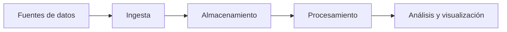

# Proyecto 4: BIGDATA

## Descripción y objetivo

Este proyecto tiene como objetivo preparar una estructura de trabajo para organizar la ingesta, el almacenamiento y el procesamiento de datos dentro del módulo de Big Data. El resultado será un flujo de trabajo documentado que permita preparar los datos para su análisis y visualización.

## Arquitectura



## Estructura del repositorio

```text
P4BIGDATA/
├── .gitignore
├── README.md
├── ingesta/
├── etl/
└── dashboard/
```

## Tecnologías

- Python 3.10 o superior.
- Git y GitHub.
- Herramientas de ingesta y procesamiento de datos.